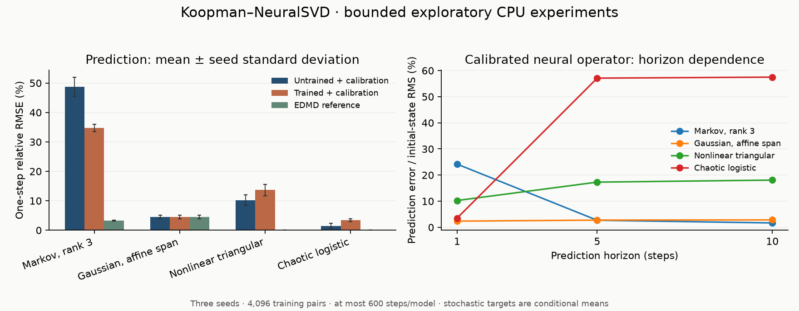

# Koopman–NeuralSVD

Learn singular functions of a Koopman conditional-expectation operator from lagged state pairs using neural networks and the **jointly nested low-rank objective**. This refresh adds an installable package, bounded CPU experiments, train/validation/test separation, correct multi-step operator composition, checkpoints, and regression tests.

The original 2024 NeuralSVD experiments remain in `methods/`, `examples/`, and `scripts/`; their instructions are preserved in [the upstream README](docs/upstream-neuralsvd.md). The new supported identification API is `koopman_svd`. Historical experiment dependencies are not installed by the new package.

## Quick start

Python 3.10 or newer:

```bash
python -m venv .venv
source .venv/bin/activate
python -m pip install torch --index-url https://download.pytorch.org/whl/cpu
python -m pip install -e '.[test]'
python -m pytest -q
koopman-svd-benchmark --quick --seeds 0 --output runs/quick
```

For the small three-seed benchmark recorded in this repository:

```bash
koopman-svd-benchmark --seeds 0 1 2 --output reports/smoke
```

The default is **600 optimization steps per model**, four tiny synthetic cases per seed, CPU only, with a 30-second optimization cap per model. This is a smoke experiment, not a large training job. No experiment runs merely by importing the package. See [recorded results](reports/smoke/results.md), [mathematics and validity limits](docs/mathematics.md), and [the audit](docs/audit.md).

Start with the [results summary](reports/README.md) for the measured accuracy, negative results, and remaining scientific tests.

Additional bounded checks:

```bash
koopman-svd-benchmark --cases markov --markov-rank 4 --seeds 0 1 2 --output reports/full-rank
koopman-svd-benchmark --cases gaussian_affine --steps 2000 --batch-size 1024 --seeds 0 1 2 --output reports/affine-refinement
python -m koopman_svd.experiments_refinement --output reports/forecast
```

The 2,000-step refinement fits tiny affine networks on three-dimensional states; it tests raw singular-factor convergence within seconds, rather than launching a large training run. `requirements-tested.txt` records the tested Python 3.12 environment. The minimum supported dependency ranges are in `pyproject.toml`.



## Fit your own transition pairs

```python
import numpy as np
from koopman_svd import NeuralKoopmanSVD

rng = np.random.default_rng(7)
x = rng.normal(size=(4096, 2))
y = 0.7*x + np.sqrt(1-0.7**2)*rng.normal(size=x.shape)
xv = rng.normal(size=(1024, 2))
yv = 0.7*xv + np.sqrt(1-0.7**2)*rng.normal(size=xv.shape)

model = NeuralKoopmanSVD(input_dim=2, rank=3, hidden_dims=(), seed=0)
model.fit(x, y, validation_data=(xv, yv), steps=300, max_seconds=20)
print(model.singular_values_)  # Post-fit, learned-subspace spectrum
print(model.raw_singular_values_)  # Raw factor-norm estimates, before calibration
prediction = model.predict(xv[:8], steps=5)
model.save('model.pt')
restored = NeuralKoopmanSVD.load('model.pt')
```

`rank` includes a fixed constant by default. `hidden_dims=()` learns affine functions; use hidden layers such as `(32, 32)` for nonlinear representations. NumPy input produces NumPy output; tensor input produces tensor output. `fit` uses training data for normalization and calibration and validation data for checkpoint selection. Keep test data separate.

## Trajectories and Kooplearn

```python
from koopman_svd.data import trajectory_pairs, trajectories_to_pairs, split_trajectories

# Split independently generated trajectories BEFORE constructing overlapping windows.
split = split_trajectories(trajectories, seed=0)
x, y = trajectories_to_pairs(split.train, lag=1, lookback=1)
xv, yv = trajectories_to_pairs(split.validation, lag=1, lookback=1)
```

`trajectory_pairs` accepts time-series arrays and current Kooplearn trajectory objects exposing `to_numpy()`. `context_pairs` handles explicitly supplied `[samples, context, ...]` arrays or historical context datasets exposing `.data`. `lookback` forms flattened history windows; it is not a network embedding dimension. For a single long trajectory, use chronologically separated segments with a sufficient gap; randomly splitting overlapping windows leaks observations.

Install optional current Kooplearn integration with `python -m pip install -e '.[kooplearn]'`. Kooplearn 2.x changed the old `TensorContextDataset` API; this package uses a small explicit data adapter rather than relying on removed internals. It supplies its own prediction API and does not claim to subclass every Kooplearn estimator.

## What is actually learned?

For paired states `(X,Y)`, the target is `K h(x) = E[h(Y) | X=x]`, mapping target-marginal observables to source-marginal observables. Separate neural networks parameterize source/left factors `f(X)` and target/right factors `g(Y)`. Training minimizes a weighted sum of prefix objectives

```text
-2 E[f(X)·g(Y)] + sum_ij E[f_i(X)f_j(X)] E[g_i(Y)g_j(Y)].
```

The alignment uses paired samples. The Gram-product uses independently sampled source and target marginal indices. There is **no SVD, inverse, or eigendecomposition in neural optimization**. After fitting, a small dense factorization calibrates the learned span into orthonormal singular functions and a finite projected operator. The report distinguishes this calibrated result from raw neural factor estimates.

Prediction composes the finite kernel using the left/right basis overlap. Singular values are not eigenvalues; raising each singular value to a time power is generally incorrect. See the [derivation](docs/mathematics.md).

## Optional forecasting refinement

```python
from koopman_svd.forecast import StateAugmentedEDMD

forecast = StateAugmentedEDMD(model).fit(x, y)  # Training data only
prediction = forecast.predict(xv[:8], steps=5)
print(forecast.spectral_diagnostics())
```

This fits a **separate EDMD operator** on `[constant, observed state, learned left functions]`. It can improve state forecasts without changing the learned NeuralSVD factors or their spectrum. Select its rank and ridge parameter on validation data at the horizons relevant to your task. Refit the head if the underlying neural model changes. It does not impose stability. See [the bounded forecasting comparison](reports/forecast/results.md); the exact polynomial reference remains stronger on the specially constructed triangular example.

## Scope and limitations

- The exact-spectrum Markov example validates finite stochastic compression. The Gaussian example validates the operator restricted to affine observables; a complete affine span plus calibration is an EDMD-type sanity check, not evidence of a neural advantage.
- The nonlinear triangular map and chaotic logistic map assess predictions. The noiseless deterministic operator between its natural marginal spaces is an isometry; infinite-dimensional compactness and a decaying singular spectrum cannot be assumed.
- Small synthetic experiments do not certify accuracy on a new dataset, large dimensions, continuous-time generators, or controlled dynamics. The model identifies a discrete lagged operator. No controller stability guarantee is claimed.
- Multi-step composition requires a common state domain and meaningful evaluation of source functions on target states. Nonstationary distribution shift can make it unreliable.
- The package provides finite-rank/moment diagnostics, not a certificate of infinite-dimensional operator-norm convergence. Validation loss and prediction quality need not rank models identically.

## Attribution

The historical code is derived from [Jongha Jon Ryu's NeuralSVD repository](https://github.com/jongharyu/neural-svd), under its retained MIT license. This repository integrates these established methods; it does not claim a new invention of neural Koopman SVD.

1. Ryu et al., **Operator SVD with Neural Networks via Nested Low-Rank Approximation**, ICML 2024. [Paper](https://proceedings.mlr.press/v235/ryu24b.html).
2. Jeong, Ryu, Yun and Wornell, **Efficient Parametric SVD of Koopman Operator for Stochastic Dynamical Systems**, NeurIPS 2025. [Paper](https://arxiv.org/abs/2507.07222), [official implementation](https://github.com/MinchanJeong/NeuralKoopmanSVD).
3. [Kooplearn](https://github.com/Machine-Learning-Dynamical-Systems/kooplearn), used through an optional data adapter; its full benchmark suite is not reproduced here.
