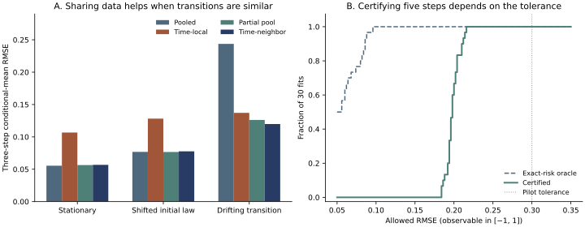
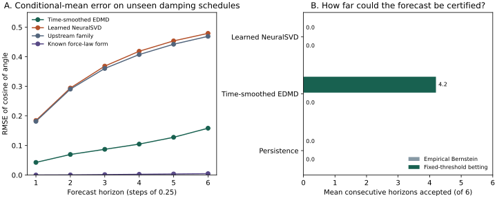

# Verified results and remaining limits

The implementation is operational and the mathematical direction has demonstrable potential in these finite stochastic checks. This is a reproducible exploratory CPU study, not a full training campaign or evidence of general superiority over EDMD. Values below are means ± population standard deviations across seeds 0, 1, 2.

| Quantity | Result | Meaning |
|---|---:|---|
| Raw neural top-3 Markov spectrum error | 1.30% ± 0.22% | Ordered neural factor-norm estimates before dense calibration |
| Raw neural affine-Gaussian spectrum error after refinement | 1.24% ± 0.49% | 2,000 updates of a tiny 3D affine network, batch 1,024 |
| Calibrated affine-Gaussian spectrum error | 0.89% ± 0.50% | Finite affine-subspace reference; not the full nonlinear Gaussian spectrum |
| Full-rank Markov one-step conditional-mean error | 3.23% ± 0.18% | Equal to the fitted full-state EDMD reference here |
| Triangular one-step error, standard singular-kernel predictor | 13.64% ± 1.96% | General learned rank-six dictionary |
| Triangular one-step error, optional forecasting head | 5.96% ± 2.57% | Separate state-augmented EDMD; does not improve the SVD itself |
| Logistic one-step error, standard predictor | 3.50% ± 0.46% | Long-horizon individual predictions remain poor |
| Logistic ten-step error, standard predictor | 57.56% ± 0.28% | Illustrates the limited forecast horizon |

Relative errors use RMS ground-truth magnitude. Long-horizon ground truths of contracting systems can approach zero: the detailed JSON also records absolute RMSE and normalization by initial-state RMS.

## Follow-up: changing state distributions and forecast reliability

The [study and implementation guide](../docs/nonstationary.md) explains the time-indexed singular bases, the statistical contract and when to pool transitions. All errors below are conditional-mean RMSE in each experiment's own units. The comparisons have different endpoints; compare only within a row.

| Experiment | Finding | Evidence and boundary |
|---|---|---|
| Gaussian transitions with smooth drift, 30 seeds | Time-local 0.1371 → validation-selected partial pooling 0.1262 at three steps. Paired mean difference −0.01090, descriptive 95% seed-bootstrap interval [−0.01494, −0.00711]. | [Fixed design and result](gaussian-transport/README.md). A subsequent [time-neighbor smoother](gaussian-transport/smoothing.md) reached 0.1198 but did not beat global pooling on homogeneous controls. Affine model, no neural advantage. |
| Finite chain and warped circle, five horizons | Under switching, adaptive pooling dropped RMSE 0.1579 → 0.0182 (chain) and 0.2549 → 0.0326 (circle), essentially matching time-specific EDMD. It preferred pooled forecasts under homogeneous transitions. | [Fresh-seed comparison](nonstationary/pooling.md); [bridge, rank and baseline ablations](nonstationary/README.md). Improvement over pooled EDMD certified in 27/50 switching seed–horizon cells, none over time EDMD. |
| Small neural experiment, 32 states | Frozen 0.7061 → trained 0.2813 across three horizons. Full tabular EDMD: 0.0800. | [Neural ablation](neural-transport/results.md): three seeds and 64 updates per tiny fit. A gain over initialization, not over the strongest baseline. |
| Known two-class predictive mode | On fresh seeds, two-means recalibration changed learned-neural RMSE 0.2761 → 0.0235; the equally recalibrated tabular model also obtained 0.0235. | [Exploratory class-structure ablation](neural-partition/results.md). The median rule was unstable. This gain exploits a true two-class structure deliberately built into the system. |
| Choosing whether to discretize a mode | With 65,536 independent calibration starts, a conservative selector attained 0.0376 RMSE on the binary task (soft 0.0859, two-model oracle 0.0326); it retained the soft model on a four-level task, attaining 0.0995. With 1,024 starts it abstained on both tasks. | [Fresh structural-selection experiment](partition-selection/results.md). Tabular singular scores; no new neural training. Abstention deploys the prespecified soft fallback. |

A [matched finite-support refinement](finite-support-selection/results.md) used fresh fitting seeds. At 8,192 calibration starts on the binary system, replacing the universal score range by the valid range over all 32 possible states increased certified hard-mode decisions from 0.5% to 31.2%; selected RMSE fell from 0.0846 to 0.0612 (oracle 0.0305). On the four-level task it identified harm more often, and both procedures retained the soft model. Both abstained at 1,024. This lever is available only with an independently justified global range; sample extrema are insufficient.

Left: three-step joint forward/reverse error across 30 fits. Right: post hoc sensitivity of the same simultaneous upper bounds on 30 fitted chain/circle families. With 4,096 calibration starts no model certified even one step at tolerance 0.15; all 30 certified all five at 0.30. An exact-risk oracle in the plotted menu often accepts far more than the finite-sample bound. Recreate the figure with `python scripts/plot_transport_results.py` after installing the plots extra. These experiments do not establish novelty, real-world transfer, or control guarantees.

## Stochastic pendulum: finish the scale-up decision

The [fixed protocol](pendulum/protocol.md) compared neural learning against matched frozen features, smoothed EDMD, direct regression and the actual upstream implementation. None saw held-out transition pairs while fitting. Five fit seeds, two unseen damping schedules and six forecast horizons were used. Full and angle-only observations have different conditional targets.

| Question | Answer |
|---|---|
| Did learned features outperform classical identification? | **No** on the primary full-observation test. Six-step RMSE: learned 0.47935, frozen 0.46983, upstream family 0.46920, smoothed EDMD 0.15850. The smaller/faster representation failed the accuracy margin. [All candidate scores](pendulum/results.md) |
| What if the pendulum structure is known? | A fit using calibrated sensors and the force-law form gave RMSE about 0.0053 in a [higher-resolution check](pendulum/mechanics.md). It has privileged structural information and is not a generic Koopman estimator. |
| Did neural models handle a sensor change? | They beat the validation-selected classical model after changing five nuisance sensors, but stable-anchor harmonic EDMD was much better than either. With velocity unobserved the neural and classical errors were close. Neither stress result reverses the main decision. |
| What did 4,096 starts buy? | The prespecified empirical Bernstein bound certified no learned steps at tolerance 0.15. On a smaller auxiliary menu a fixed-threshold betting test certified a mean 4.2 steps for the classical model, zero for the learned one. Capping updates sharpened some paired decisions; the bound covers only the capped forecast. [Proof](../docs/certification.md) · [Matched results](pendulum/certificates.md) |

**Decision:** stop scaling this neural configuration. Use schedule-smoothed EDMD with stable observations or a mechanics-informed model where that prior is warranted. All evidence is simulation-specific. No hardware/controller or infinite-dimensional generator claim is made.

## What the comparisons establish

- The rank-three Markov model improves over the same untrained neural dictionary: one-step error averages 48.69% ± 3.20% before learning versus 34.81% ± 1.24% afterward. Its truncation reference is about 33.55% ± 0.00%; retaining rank four removes most of this compression error.
- Longer but still bounded affine optimization improves raw neural singular factors. Calibration already recovered the complete affine span before training, so calibrated affine prediction does not demonstrate a neural advantage.
- NeuralSVD optimizes spectral factorization, not coordinate forecasting. In the deterministic examples, training can worsen forecasts compared with calibrated random features. Those negative results are retained.
- A separate state-augmented forecasting head helps the triangular example, but its known exact polynomial closure gives EDMD essentially machine-precision predictions. It remains the stronger baseline on that constructed problem.
- No decaying spectrum or finite-rank approximation in operator norm is claimed for the noiseless infinite-dimensional logistic Koopman operator. See [the mathematical discussion](../docs/mathematics.md).

## Artifacts and reproduction

- [Main three-seed results](smoke/results.md) and [machine-readable values](smoke/results.json).
- [Affine neural convergence refinement](affine-refinement/results.md).
- [Full-state Markov check](full-rank/results.md).
- [Separate forecasting-head selection and results](forecast/results.md).
- [Comparison figure](smoke/comparison.png).
- [Repository audit](../docs/audit.md) and [mathematical derivation](../docs/mathematics.md).

Every report contains the exact command, versions and budgets. The default smoke runs use at most 600 updates per model; the tiny affine refinement allows at most 2,000. All fitting is CPU-only and exits synchronously. No large training job was started or left running.

## Next scientific tests

1. Evaluate fixed neural architectures and baselines on a fresh stochastic nonlinear dataset, with trajectory-separated validation/test sets and explicit observation/process noise.
2. Use held-out conditional-expectation or multi-trajectory estimators to test singular equations and subspace convergence independently of calibration.
3. Study rank, sample count, minibatch noise and approximation capacity before scaling dimensions. Preserve ordered raw-spectrum, orthogonality and predictive metrics separately.
4. Compare against the direct NeurIPS 2025 NeuralKoopmanSVD implementation and current Kooplearn estimators under matched data and compute budgets.
5. Treat controlled/continuous-time dynamics as a further project: identification alone does not provide a robust controller or a stability guarantee.
